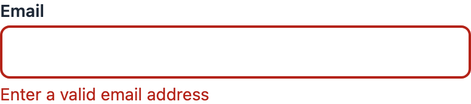
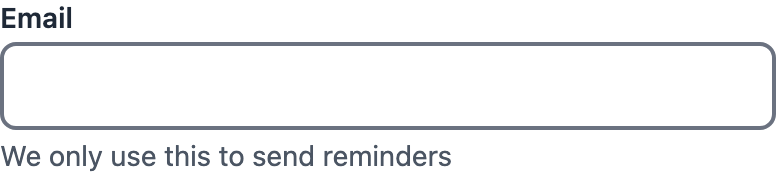
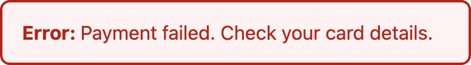

# accessible-rn-components

[](https://github.com/rveruna/accessible-rn-components/actions/workflows/ci.yml)
[](https://github.com/rveruna/accessible-rn-components/actions/workflows/codeql.yml)

**[Try the components in Storybook](https://rveruna.github.io/accessible-rn-components/?path=/story/components-banner--info&addonPanel=storybook/a11y/panel)**, with the accessibility panel open.

[](https://rveruna.github.io/accessible-rn-components/)

A small React Native component library built to show how I approach accessibility, testing and design
systems. Four simple components (Button, TextField, Toggle, Banner) and four harder ones, where accessibility
usually goes wrong (Dialog, Slider, Tabs, RadioGroup). Accessibility is checked at five levels, and the
checks are themselves tested.

| | | |
|---|---|---|
|  |  |  |
|  |  |  |
|  |  | |

## What is in it

| Component | Accessibility decisions |
|---|---|
| `Button` | Role `button`, label as accessible name, `busy` state while loading, ignores presses when disabled or loading, 44pt minimum touch target, spinner hidden from assistive tech |
| `TextField` | Visible label doubles as the accessible name, helper text or error used as the hint, error announced as an alert and the field marked invalid, read-only state keeps full text contrast |
| `Toggle` | Role `switch` with checked state, the whole row is the touch target, disabled state announced |
| `Banner` | Errors are announced assertively as alerts, other messages politely as status, meaning is carried by text as well as colour |
| `Dialog` | On web: role `dialog`, named by its title, focus moved in on open, Tab kept inside, Escape closes, focus returned to the opener. On iOS and Android: screen reader focus moved to the title, `accessibilityViewIsModal`, Android back closes. A tap outside closes it too, but the backdrop is never focusable |
| `Slider` | Role `slider` (adjustable on iOS) with min, max and the value in words (`£150`, not `150`); VoiceOver and TalkBack swipe actions; arrow, Page and Home/End keys on web; drag anywhere on a 44pt strip; when disabled only the track and thumb fade, so the label keeps full contrast |
| `Tabs` | Tab list with `tab` roles and selected state; one tab stop, arrow keys move and select with wrapping, Home/End; each panel labelled by its tab; selection shown by weight and an underline, not colour alone |
| `RadioGroup` | Group named by its question (shown once, read once); radios with checked state; one tab stop, arrows move and choose, Space chooses; an error is announced as an alert and marks the group invalid |
| Design tokens | Every text and background colour pair is checked against WCAG AA in the tests |

## How it is tested

1. **Unit tests** with React Native Testing Library, written against roles and accessible names, not implementation details (104 tests, 100% line coverage, with a 95% coverage threshold enforced).
2. **Contrast tests** that compute WCAG contrast ratios for every colour pair in the design tokens.
3. **Browser audit**: `npm run a11y-audit` builds Storybook and runs axe-core (WCAG 2.0 to 2.2, A and AA rules) in Chromium against all 26 stories. Currently 0 violations.
4. **Keyboard check**: `npm run keyboard-check` uses the built Storybook in Chromium with a real keyboard and mouse: where focus goes when the dialog opens and closes, that Tab stays inside it, that tabs and radio groups are one tab stop, and what each key does to the slider (24 checks).
5. **Mutation check**: `npm run mutation-check` deliberately breaks 27 accessibility rules one at a time and confirms the test suite fails each time (27 of 27 caught).

All five run in CI.

## What the checks found

- **The browser audit caught three real bugs that the unit tests did not.** The loading spinner exposed an unnamed `progressbar` on web (the native-only hiding props are ignored there), the read-only field used opacity and dropped below AA contrast, and the `switch` role on web needs `aria-checked`, which `accessibilityState` alone did not provide. I fixed all three and the audit now guards them: reintroducing the spinner bug makes it fail.
- **The mutation check found redundant code.** One mutation (removing `disabled` from the button's accessibility state) survived because `Pressable` already derives that state from its `disabled` prop. The line was redundant, not under-tested, so I deleted it.
- **A `View` with a role is not an accessibility element unless it is marked `accessible`.** The Banner tests failed until I added it, which is exactly the kind of bug a screen reader user would hit.
- **The keyboard check caught two bugs that the unit tests and axe both missed.** Every tab and radio button was its own tab stop, because react-native-web's `Pressable` ignores `focusable={false}` ([decision 0004](docs/decisions/0004-one-tab-stop-for-tabs-and-radio-groups.md)). And opening the dialog put focus on the invisible tap-outside backdrop, because the web focus trap focuses anything that accepts focus ([decision 0005](docs/decisions/0005-let-react-native-web-handle-dialog-focus.md)). Putting the first bug back makes the check fail.
- **The browser audit caught the disabled slider fading its label below AA contrast.** Only the track and thumb fade now, the same lesson as the read-only text field.
- **The mutation check found a test that could not fail.** Removing the slider's "ignore input while disabled" guard survived, because Testing Library never fires events on a disabled element. A screen reader can still send increment to a dimmed slider, so the guard stays and the test now calls the handler directly.

## Practices

- **CI on every push to main and every pull request:** lint, a Prettier check, an audit of production dependencies (high severity and above), the type-check, the tests with coverage, the mutation check, the browser accessibility audit and the keyboard check.
- **Before every commit:** a Husky hook formats and lints the staged files.
- **Kept current and watched:** Dependabot groups weekly updates, and CodeQL scans every push to main, every pull request and weekly.
- **Decisions are written down:** [docs/decisions](docs/decisions) records the choices that were not obvious, with their evidence, including [what each level of accessibility checking catches and misses](docs/decisions/0001-check-accessibility-in-a-real-browser.md).
- **A clean dependency split:** the library needs only `react` and `react-native`, declared as peer dependencies; everything else is development tooling, so `npm audit --omit=dev` is meaningful.

## Run it

```bash
npm install
npm test                # unit and contrast tests
npm run test:coverage   # with coverage thresholds
npm run lint
npm run format       # Prettier
npm run typecheck
npm run storybook       # http://localhost:6006, with the accessibility panel
npm run mutation-check
npm run a11y-audit      # builds Storybook, audits every story in Chromium
npm run keyboard-check  # builds Storybook, drives it with a keyboard and mouse in Chromium
```

`App.tsx` is a small demo screen that uses the four simple components (`npm run web`); the harder ones are in Storybook.

## Limits and next steps

- The browser audit runs against the web build (react-native-web). Automated checks find only part of the
  real problems, so VoiceOver and TalkBack behaviour still needs manual testing on devices, which I
  have not automated here.
- The palette is a demo, not a brand system. Dark mode and dynamic type scaling are not covered yet.
- The keyboard check covers web. VoiceOver and TalkBack on the new components (the swipe actions, focus moving to the dialog title) are covered by unit tests only, not on devices.
- Next: a `Select` (combobox), the hardest common pattern left.

## Stack

Expo SDK 57, React Native 0.86, React 19, TypeScript (strict), Jest with jest-expo, React Native Testing Library 14,
Storybook 10 with react-native-web-vite and the accessibility add-on, Playwright and axe-core.

## Licence

MIT
